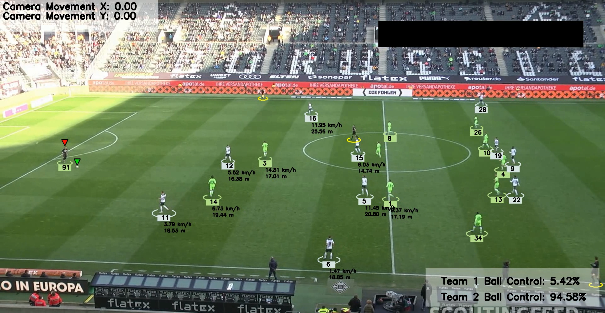
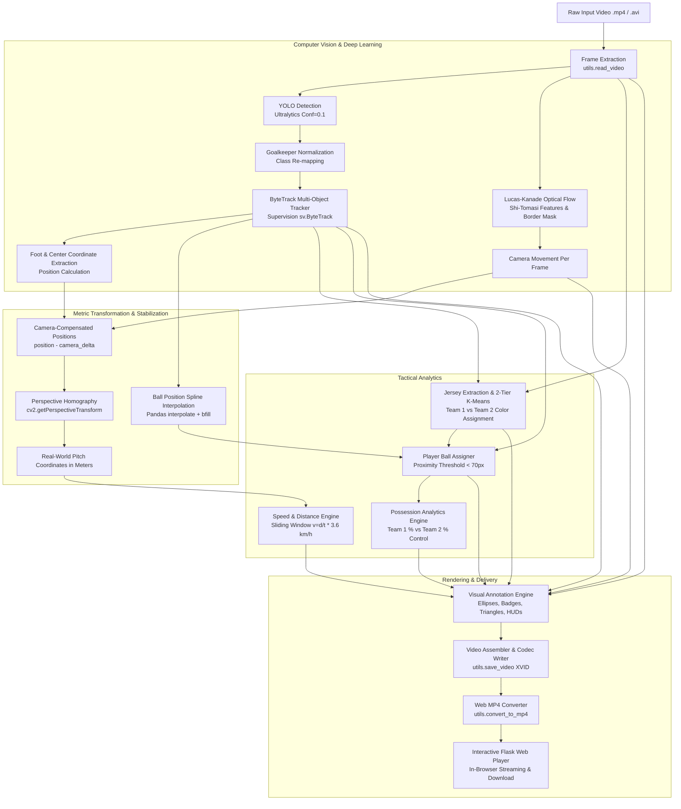

# ⚽ Football Player & Tactical Match Analytics System

[](https://www.python.org/)
[](https://github.com/ultralytics/ultralytics)
[](https://github.com/roboflow/supervision)
[](https://opencv.org/)
[](https://flask.palletsprojects.com/)
[](LICENSE)

An end-to-end **Computer Vision and Deep Learning pipeline** designed for automated football (soccer) tactical broadcast analysis. The system detects and tracks players, referees, and the ball, classifies team jerseys via unsupervised color segmentation, compensates for dynamic broadcast camera movements, projects 2D pixel coordinates into real-world pitch metrics through perspective homography, computes physical performance telemetry (speed and distance), and provides live ball possession analytics.

Includes both a **command-line pipeline** with stub caching for rapid development and an **interactive Flask web application** for video upload, automated processing, format conversion, and in-browser playback.

---

## 📸 Demo Preview



*Figure 1: Automated player tracking with team color identification, real-time ball control percentage HUD, camera movement telemetry, and per-player speed and distance estimation in meters and km/h.*

---

## 📑 Table of Contents

- [Key Features](#-key-features)
- [System Architecture](#-system-architecture)
- [Methodology & Pipeline Modules](#-methodology--pipeline-modules)
  - [1. Object Detection & Multi-Object Tracking](#1-object-detection--multi-object-tracking)
  - [2. Ball Trajectory Interpolation](#2-ball-trajectory-interpolation)
  - [3. Camera Motion Compensation (Optical Flow)](#3-camera-motion-compensation-optical-flow)
  - [4. Perspective Transformation & Metric Calibration](#4-perspective-transformation--metric-calibration)
  - [5. Speed and Distance Telemetry](#5-speed-and-distance-telemetry)
  - [6. Unsupervised Team Assignment (2-Tier K-Means)](#6-unsupervised-team-assignment-2-tier-k-means)
  - [7. Ball Acquisition & Match Possession Analytics](#7-ball-acquisition--match-possession-analytics)
  - [8. Interactive Flask Web Application](#8-interactive-flask-web-application)
- [Repository Structure](#-repository-structure)
- [Installation & Setup](#-installation--setup)
- [Pretrained Models & Datasets](#-pretrained-models--datasets)
- [Usage Guide](#-usage-guide)
  - [Running the Main Processing Pipeline](#running-the-main-processing-pipeline)
  - [Launching the Flask Web Dashboard](#launching-the-flask-web-dashboard)
  - [Running YOLO Standalone Inference](#running-yolo-standalone-inference)
  - [Custom Model Training with Roboflow](#custom-model-training-with-roboflow)
- [Configuration & Tunable Hyperparameters](#-configuration--tunable-hyperparameters)
- [Troubleshooting & FAQ](#-troubleshooting--faq)
- [Future Roadmap](#-future-roadmap)
- [Contributing & License](#-contributing--license)

---

## ✨ Key Features

- **Multi-Class Detection**: Detects players, goalkeepers, referees, and the football using a fine-tuned YOLO model.
- **Persistent ByteTrack Tracking**: Preserves unique player and referee IDs across frames even during brief occlusions or collisions.
- **Ball Recovery & Interpolation**: Employs pandas-based temporal interpolation and backfilling to smooth intermittent ball detections.
- **Camera Stabilization via Optical Flow**: Measures pan and tilt deltas using Lucas-Kanade optical flow on border-isolated features, preventing camera sweeps from distorting player positions.
- **Homography (Pixels to Real-World Meters)**: Maps the trapezoidal broadcast camera field-of-view to a calibrated rectangular pitch grid ($68\,\text{m} \times 23.32\,\text{m}$).
- **Physical Metrics Estimation**: Quantifies player sprint speed ($\text{km/h}$) and cumulative physical distance covered ($\text{m}$) over sliding temporal windows.
- **2-Tier Unsupervised Jersey Clustering**: Uses $K$-Means to isolate shirt pixels from grass/background, followed by player-level clustering to divide squads into Team 1 vs. Team 2 with zero manual labeling.
- **Possession & Ball Control HUD**: Detects ball carrier proximity ($<70\,\text{px}$) and renders a live, semi-transparent possession breakdown banner on screen.
- **Caching / Stub Acceleration**: Serializes expensive tracking and optical flow calculations to pickle stubs (`stubs/`), allowing instant UI iterations and rapid downstream testing without a GPU.
- **Full-Stack Web Interface**: Upload any match clip through a clean Flask UI, automatically execute the analysis, convert output to stream-ready MP4 via OpenCV, and watch or download the result.

---

## 🏗️ System Architecture



---

## 🔬 Methodology & Pipeline Modules

### 1. Object Detection & Multi-Object Tracking
- **Model**: Custom fine-tuned YOLO (YOLOv5x / YOLOv8s) trained on soccer broadcast frames.
- **Classes**: `player` (0), `goalkeeper` (1), `referee` (2), `ball` (3).
- **Goalkeeper Normalization**: In `trackers/tracker.py`, detections labeled as `goalkeeper` are mapped to `player` so they participate seamlessly in squad tracking, team assignment, and physical metric estimations.
- **Tracker**: `sv.ByteTrack()` maintains association across video frames using bounding box spatial overlap and motion velocity.
- **Anchor Reference**: Outfield players and referees are anchored at foot position $(x_{\text{center}}, y_{\text{bottom}})$, while the football is anchored at the bounding box centroid $(x_{\text{center}}, y_{\text{center}})$.

### 2. Ball Trajectory Interpolation
Football detection is prone to sporadic missed detections when the ball moves rapidly or is occluded by players' bodies. In `Tracker.interpolate_ball_positions`, missing frame coordinates are structured into a `pandas.DataFrame` and smoothed via:
$$\text{Missing Coordinates} \leftarrow \text{df.interpolate().bfill()}$$
This guarantees continuous trajectory tracking without flickering annotation artifacts.

### 3. Camera Motion Compensation (Optical Flow)
Broadcast cameras constantly pan, tilt, and zoom following match action. Without compensation, panning makes stationary players appear to be moving across the pitch.
- **Feature Selection**: Shi-Tomasi corners (`cv2.goodFeaturesToTrack`) are detected specifically on stationary peripheral areas (border columns $x \in [0, 20]$ and $x \in [900, 1050]$), explicitly masking out the central active pitch where players move.
- **Tracking**: Lucas-Kanade pyramidal optical flow (`cv2.calcOpticalFlowPyrLK`) measures frame-to-frame shifts:
$$\Delta x = x_{\text{old}} - x_{\text{new}}, \quad \Delta y = y_{\text{old}} - y_{\text{new}}$$
- **Adjustment**: A movement deadzone threshold ($>5\,\text{px}$) discards optical noise. Adjusted coordinates are computed as:
$$\vec{P}_{\text{adjusted}} = \vec{P}_{\text{pixel}} - \vec{\Delta}_{\text{camera}}$$

### 4. Perspective Transformation & Metric Calibration
Camera foreshortening means 1 pixel near the bottom of the screen represents far fewer real-world centimeters than 1 pixel near the top of the broadcast frame.
- In `view_transformer/view_transformer.py`, four reference field markings are calibrated against standard pitch dimensions:
  - Pixel quadrilateral: $[(110, 1035), (265, 275), (910, 260), (1640, 915)]$
  - Canonical pitch dimensions: $23.32\,\text{m} \times 68\,\text{m}$
- A $3 \times 3$ Homography Matrix $\mathbf{H}$ is derived via `cv2.getPerspectiveTransform`:
$$\begin{bmatrix} x' \\ y' \\ 1 \end{bmatrix} \sim \mathbf{H} \begin{bmatrix} x \\ y \\ 1 \end{bmatrix}$$
- Points outside the calibrated polygon are safely rejected using `cv2.pointPolygonTest` to prevent extreme coordinate distortion.

### 5. Speed and Distance Telemetry
The module `speed_and_distance_estimator/speed_and_distance_estimator.py` assesses physical performance over a sliding temporal window ($\Delta t$):
- **Window size**: $\Delta F = 5$ frames at 24 FPS ($\Delta t = 5 / 24 \approx 0.208\,\text{s}$).
- **Distance**:
$$d = \sqrt{(x_{t+\Delta t} - x_t)^2 + (y_{t+\Delta t} - y_t)^2} \quad (\text{meters})$$
- **Velocity**:
$$v = \left(\frac{d}{\Delta t}\right) \times 3.6 \quad (\text{km/h})$$
- Speed and cumulative distance covered are rendered beneath each player's bounding box.

### 6. Unsupervised Team Assignment (2-Tier K-Means)
Automated jersey assignment operates in two stages without requiring manual template matching:
1. **Pixel Clustering**: The upper half of the player's bounding box (jersey region) is sliced. $K$-Means ($K=2$) separates uniform pixels from pitch/background pixels. Because corner pixels represent pitch grass or background, the cluster furthest from the corners is selected as the representative jersey color.
2. **Team Clustering**: Jersey colors collected across all detected players in the opening frame are clustered ($K=2$) into Team 1 and Team 2 centroids. Players are assigned their squad's uniform color throughout the match.

### 7. Ball Acquisition & Match Possession Analytics
- Proximity between the ball's center and each player's left and right foot bounding box points is evaluated:
$$d_{\text{ball}} = \min\left(\|\vec{P}_{\text{ball}} - \vec{P}_{\text{foot,left}}\|, \|\vec{P}_{\text{ball}} - \vec{P}_{\text{foot,right}}\|\right)$$
- If $\min(d_{\text{ball}}) < 70\,\text{pixels}$, possession is attributed to that player.
- Ball possession ratios are continuously updated and displayed on a semi-transparent HUD banner:
$$\text{Possession}_{\text{Team } i} = \frac{\sum \text{Frames}_{\text{Team } i}}{\sum \text{Frames}_{\text{Team 1}} + \sum \text{Frames}_{\text{Team 2}}} \times 100\%$$

### 8. Interactive Flask Web Application
- **Frontend**: Clean glassmorphism-inspired UI with custom CSS gradients, responsive file upload cards, and HTML5 video streaming.
- **Conversion Pipeline**: Since OpenCV writes raw AVI files (`XVID`), `utils/convert_to_mp4.py` automatically encodes the output into web-standard MP4 (`mp4v`), enabling zero-lag browser playback and instant video downloads.

---

## 📁 Repository Structure

```text
Football-Player-Analysis/
├── app.py                             # Flask web application entrypoint
├── main.py                            # Standalone end-to-end processing pipeline
├── yolo_inference.py                  # Standalone YOLO test & inspection script
├── requirements.txt                   # Dependency manifest for pip
├── README.md                          # Project documentation
│
├── camera_movement_estimator/         # Camera pan/tilt motion compensation
│   ├── __init__.py
│   └── camera_movement_estimator.py   # Lucas-Kanade optical flow on border corners
│
├── player_ball_assigner/              # Ball proximity detection
│   ├── __init__.py
│   └── player_ball_assigner.py        # Proximity thresholding (< 70px)
│
├── speed_and_distance_estimator/      # Physical performance telemetry
│   ├── __init__.py
│   └── speed_and_distance_estimator.py# Sliding-window velocity & cumulative distance
│
├── team_assigner/                     # Unsupervised jersey color segmentation
│   ├── __init__.py
│   └── team_assigner.py               # 2-Tier K-Means clustering algorithm
│
├── trackers/                          # Object detection & multi-target tracking
│   ├── __init__.py
│   └── tracker.py                     # ByteTrack wrapper, ball interpolation & HUD drawing
│
├── view_transformer/                  # Metric homography projection
│   ├── __init__.py
│   └── view_transformer.py            # Perspective transformation (pixels -> meters)
│
├── utils/                             # Shared utility functions
│   ├── __init__.py
│   ├── bbox_utils.py                  # Geometric calculations (centroid, foot, Euclidean distance)
│   ├── convert_to_mp4.py              # OpenCV AVI to MP4 transcoder for browsers
│   └── video_utils.py                 # Video reader and XVID VideoWriter helper
│
├── templates/                         # Flask HTML templates
│   ├── index.html                     # File upload interface
│   └── play_video.html                # In-browser video player with download link
│
├── static/                            # Web assets and visual demonstrations
│   ├── screenshot.png                 # Sample output frame with full annotations
│   ├── styles.css                     # Responsive styling
│   └── scripts.js                     # Frontend interaction helpers
│
├── input_videos/                      # Raw test footage directory
│   └── input_video0.mp4               # Sample broadcast football match clip
│
├── stubs/                             # Serialized pickle caches for instant execution
│   ├── camera_movement_stub.pkl       # Pre-computed optical flow shifts
│   └── track_stubs.pkl                # Pre-computed YOLO + ByteTrack detections
│
├── development_and_analysis/          # Exploratory research notebooks
│   └── color_assignement.ipynb        # Prototyping K-Means jersey color segmentation
│
├── training/                          # Model training scripts and notebooks
│   └── football_training_yolo_v5.ipynb# YOLOv5 training on Roboflow dataset
└── modle-training.ipynb               # Kaggle/Colab YOLOv8s & YOLOv5xu training notebook
```

---

## 🚀 Installation & Setup

### 1. Prerequisites
- **Python**: Version `3.8` through `3.12` recommended.
- **Git**: For cloning the repository.
- **Hardware**: GPU with CUDA support recommended for high-speed YOLO inference. (CPU execution is fully supported via pre-computed stubs).

### 2. Clone the Repository
```bash
git clone https://github.com/Chaitanya210904/Football-Player-Analysis.git
cd Football-Player-Analysis
```

### 3. Create and Activate a Virtual Environment
```bash
# macOS / Linux
python3 -m venv venv
source venv/bin/activate

# Windows (Command Prompt)
python -m venv venv
venv\Scripts\activate.bat

# Windows (PowerShell)
python -m venv venv
venv\Scripts\Activate.ps1
```

### 4. Install Dependencies
```bash
pip install --upgrade pip
pip install -r requirements.txt
```

---

## 📦 Pretrained Models & Datasets

### 1. Pretrained YOLO Weights
To run inference on new, un-cached videos, download the trained model weights and place them into a `models/` directory:

| Resource | Download Link | Destination Path |
| :--- | :--- | :--- |
| **Fine-Tuned YOLO Weights** | [Google Drive Download](https://drive.google.com/file/d/1DC2kCygbBWUKheQ_9cFziCsYVSRw6axK/view?usp=sharing) | `models/best.pt` |
| **Sample Match Footage** | [Google Drive Download](https://drive.google.com/file/d/1t6agoqggZKx6thamUuPAIdN_1zR9v9S_/view?usp=sharing) | `input_videos/input_video0.mp4` |

Create the `models/` directory if it does not already exist:
```bash
mkdir -p models
# Move your downloaded best.pt into models/best.pt
```

### 2. Roboflow Dataset
The model was fine-tuned on the Roboflow **football-players-detection** dataset:
- **Classes**: `player`, `goalkeeper`, `referee`, `ball`
- **Project**: `roboflow-jvuqo / football-players-detection-3zvbc`
- **Formats**: YOLOv5 PyTorch, YOLOv8

---

## 💻 Usage Guide

### Running the Main Processing Pipeline
Execute the full CLI processing pipeline on the default video:
```bash
python main.py
```
By default, `main.py`:
1. Reads `input_videos/input_video0.mp4`.
2. Utilizes pre-computed cached stubs (`stubs/track_stubs.pkl` and `stubs/camera_movement_stub.pkl`) for rapid testing without requiring GPU inference.
3. Performs perspective transformation, speed and distance tracking, team color assignment, and possession calculation.
4. Generates an annotated video saved to `output_videos/output_video1.avi`.

> [!TIP]
> **Processing New Videos Without Stubs:**
> To process fresh footage, open `main.py` and set `read_from_stub=False`:
> ```python
> tracks = tracker.get_object_tracks(video_frames, read_from_stub=False)
> camera_movement_per_frame = camera_movement_estimator.get_camera_movement(video_frames, read_from_stub=False)
> ```

---

### Launching the Flask Web Dashboard
Run the interactive Flask web server:
```bash
python app.py
```
Open your browser and navigate to:
```text
http://127.0.0.1:5000/
```
1. Click **Choose a video file** and select any `.mp4` or `.avi` soccer match recording.
2. Click **Process Video**.
3. Watch the real-time processing complete; you will be redirected to `http://127.0.0.1:5000/play/output.mp4`.
4. Play the processed video directly in your browser or click **Download Video**.

---

### Running YOLO Standalone Inference
To inspect raw YOLO bounding box predictions and confidence scores on individual frames:
```bash
python yolo_inference.py
```

---

### Custom Model Training with Roboflow
To train or fine-tune YOLO on custom broadcast data:
1. Open either `modle-training.ipynb` (Kaggle/Colab) or `training/football_training_yolo_v5.ipynb`.
2. Enter your Roboflow API key and download the dataset:
   ```python
   from roboflow import Roboflow
   rf = Roboflow(api_key="YOUR_ROBOFLOW_API_KEY")
   project = rf.workspace("roboflow-jvuqo").project("football-players-detection-3zvbc")
   dataset = project.version(1).download("yolov8")
   ```
3. Train the model using the Ultralytics CLI:
   ```bash
   yolo task=detect mode=train model=yolov8s.pt data={dataset.location}/data.yaml epochs=50 imgsz=640 batch=16
   ```

---

## ⚙️ Configuration & Tunable Hyperparameters

Key parameters can be easily tuned across the codebase depending on camera setup and match footage:

| Parameter | Default Value | File Location | Purpose |
| :--- | :--- | :--- | :--- |
| `batch_size` | `20` | `trackers/tracker.py` | Batch size for YOLO frame inference |
| `conf` | `0.1` | `trackers/tracker.py` | Minimum detection confidence threshold |
| `minimum_distance` | `5` px | `camera_movement_estimator/` | Deadzone threshold to ignore optical flow jitter |
| `court_width` | `68` m | `view_transformer/view_transformer.py` | Physical width of the pitch |
| `court_length` | `23.32` m | `view_transformer/view_transformer.py` | Calibrated length of the pitch section |
| `frame_window` | `5` frames | `speed_and_distance_estimator/` | Window step for velocity calculation |
| `frame_rate` | `24` fps | `speed_and_distance_estimator/` | Frame rate for physical metric conversion |
| `max_player_ball_distance`| `70` px | `player_ball_assigner/` | Distance threshold for ball possession attribution |

---

## 🛠️ Troubleshooting & FAQ

<details>
<summary><b>Q1: Getting <code>FileNotFoundError: [Errno 2] No such file or directory: 'models/best.pt'</code></b></summary>

**Solution:** The model weight file is too large to store in git. Download `best.pt` from the [Pretrained Models Link](#-pretrained-models--datasets), create a `models/` directory in the repository root, and place the file as `models/best.pt`.
</details>

<details>
<summary><b>Q2: How do I test the pipeline without a GPU or without downloading the model?</b></summary>

**Solution:** In `main.py`, leave `read_from_stub=True`. The repository ships with pre-generated tracking and camera shift stubs (`stubs/track_stubs.pkl` and `stubs/camera_movement_stub.pkl`). The pipeline will immediately run in seconds on any CPU!
</details>

<details>
<summary><b>Q3: Video does not play in the web browser after processing.</b></summary>

**Solution:** Most web browsers cannot decode raw `.avi` (XVID) video streams. `app.py` automatically uses `utils/convert_to_mp4.py` to transcode the output to MP4 with the `mp4v` codec. Ensure your OpenCV installation has video codec support enabled (`pip install opencv-python`).
</details>

<details>
<summary><b>Q4: Speed and distance show 0 or values are missing for some players.</b></summary>

**Solution:** Perspective transformation uses `cv2.pointPolygonTest` to ensure that only coordinates inside the calibrated 4-point quadrilateral pitch area are converted to meters. Players outside the quadrilateral (e.g., near distant stands) are ignored to prevent distorted mathematical projections.
</details>

---

## 🗺️ Future Roadmap

- [ ] **2D Minimap / Tactical Radar**: Real-time top-down 2D minimap showing bird's-eye player positions and ball movements.
- [ ] **Player Voronoi Diagrams**: Pitch space control partition diagrams illustrating dynamic territorial dominance.
- [ ] **Automated Pitch Line Detection**: Automatic field keypoint detection to calibrate homography dynamically across arbitrary camera angles.
- [ ] **Passing & Shot Analytics**: Pass completion probability, sequence detection, and shot speed metrics.
- [ ] **Player Re-Identification (ReID)**: Deep ReID embeddings to re-link player tracks after prolonged out-of-frame excursions.

---

## 🤝 Contributing & License

Contributions, issues, and feature suggestions are welcome! Feel free to open a pull request or submit an issue.

Distributed under the **MIT License**. See `LICENSE` for more information.

---

<div align="center">
  <sub>Built with ❤️ for Football Analytics and Computer Vision Research.</sub>
</div>